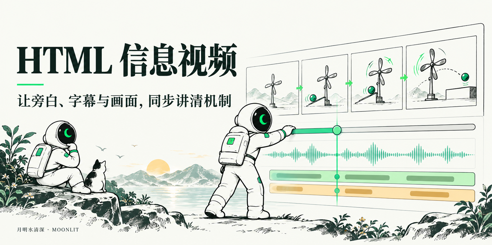

# 月明·HTML 信息视频

用 HTML 动效、真实截图和解释图制作横版信息视频，让旁白、字幕、章节与画面沿同一条时间线推进。

## 你会得到什么

- 可编辑的 HTML 视频工程与场景数据
- 按主音频和 SRT 对齐的审看预览
- 用户确认后按项目要求渲染的交付视频

## 试着这样说

```text
用 moonlit-html-video。按这份脚本制作 HTML 信息视频。先检查配音和 SRT，安排每段画面的解释任务，再给我预览。
```

## 安装与首次使用

将本仓库的完整目录交给支持本地 Skill 的 Agent 安装，保留 `SKILL.md` 与随附资源。已有同名版本时先检查差异；使用版本锁的工作区沿用自身升级机制。

让 Agent 安装：

```text
请安装这个 Skill：https://github.com/zzyong24/moonlit-html-video
```

也可通过 Skills CLI 安装：

```bash
npx skills add zzyong24/moonlit-html-video
```

## 配置与依赖

需要 Python、Node.js、项目渲染依赖与媒体工具，并配合 video-editing。新配音需配置所选服务；配音需填写本人已授权且当前账号可用的音色 ID。解释图按需依赖 moonlit-material-illustration，成片封面依赖 moonlit-video-cover。

## 数据与使用边界

旁白文本发送给所选配音服务，生图输入交给图像服务；截图和工程按使用方约定保存。真人出镜和数字人分别使用对应制作 Skill。视频生成和渲染效果需要以实际项目验收。

## 配套 Skill

[material-illustration](https://github.com/zzyong24/moonlit-material-illustration) · [video-cover](https://github.com/zzyong24/moonlit-video-cover)

## 详细说明

执行流程与资源导航见 [SKILL.md](SKILL.md)。安装检查不代表真实业务验收；需要外部服务、账号登录或付费生成的步骤，应在使用者自己的环境中验证。

---

月明水清深 · `moonlit-html-video`

首图为 AI 生成的品牌概念插画，不是工具截图或执行结果。
